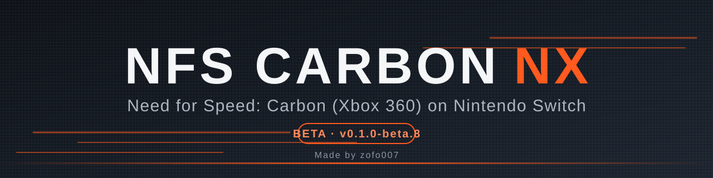

<div align="center">



 -lightgrey)  [](https://ko-fi.com/ojojoj)

[Status](#status) · [Install](#install) · [Overclocking](#overclocking) · [Known issues](#known-issues) · [Send logs](#help-improve-it-send-your-logs) · [Docs](#documentation) · [Credits](#credits)

</div>

# NFS Carbon NX

Need for Speed: Carbon (Xbox 360, 2006) running natively on the Nintendo Switch.

This is not an emulator. The PowerPC code of the game's `default.xex` is translated to C++ with
[ReXGlue](https://github.com/rexglue/rexglue-sdk) and compiled for the Switch. The game's GPU commands are drawn
by a native Vulkan renderer running on NVK (Mesa). It runs the **Xbox 360 release** of the game, not the original
Xbox version. You need your own copy of the Xbox 360 game.

> [!WARNING]
> **Beta, and it needs an overclock.** It boots, plays and saves. At stock handheld clocks it is too slow and the audio
> stutters. At the reference overclock (CPU 1428 MHz, GPU 768 MHz, memory 1600 MHz) it plays at about 30 FPS or better.
> Read [Overclocking](#overclocking) and [Known issues](#known-issues) first.

## Status

| Area | State |
|---|---|
| Boot, menus, career, saves | Work (saves persist across launches) |
| Races | Playable. Two measured sessions at CPU 1428 / GPU 768 / RAM 1600 MHz (scene at 90%, plain scaling): median 32 and 38 FPS, 53% and 93% of the time at 30 FPS or more ([details](docs/PERFORMANCE.md)). The densest scenes fall to the low 20s. With the new default (80% with FSR upscaling, quiet log) a 15-minute session at the same clocks ran at a median of 40.8 FPS, 95% of the time at 30 FPS or more (different scenes, so not a strict comparison) |
| Cutscenes | Work, decoded with FFmpeg and checked against the game's own decoder at the start of each movie |
| Audio | Almost clean at the reference clocks. Not perfect: see Known issues |
| Controller rumble | On by default (`input_vibracion`) |
| Long sessions | Fixed in 0.1.0-beta.7: texture memory is now capped, so a 90-minute session no longer runs out of memory |
| DLC packages | **Can be loaded**: put the packages in `dlc/` and the game reads them (see DLC) |
| Achievements | Not confirmed to work |
| Other editions / regions | Not supported. Only one edition has been tested (see below) |

The numbers above were measured at CPU 1428 MHz, GPU 768 MHz, memory 1600 MHz. Stock handheld clocks are CPU 1020 MHz
and GPU 460 MHz. See the next section.

## Overclocking

The game's code runs on three Switch cores and the CPU is the limit, so this port **is meant to be used with a CPU
overclock**. The reference settings are CPU 1428 MHz, GPU 768 MHz and memory 1600 MHz. In the maintainer's tests with them:

- one measured session at 1428 MHz (scene resolution 90%, plain scaling) ran at a median of 38 FPS with 93% of the time at 30 FPS
  or more, and audio drop-outs were rare ([docs/PERFORMANCE.md](docs/PERFORMANCE.md));
- a longer 22-minute session ran at a median of 32 FPS, with 53% of the time at 30 FPS or more and 2% under 25;
- open roads run 40-50 FPS, the densest city scenes about 20-30;
- with the beta.7 defaults (80% with FSR) a 15-minute session ran at a median of 40.8 FPS, 84 of 88 windows at 30 FPS
  or more, lowest 21.3 ([docs/PERFORMANCE.md](docs/PERFORMANCE.md));
- audio drop-outs are rare, but they still happen around the start of a race (see Known issues).

Use a clock manager of your choice (for example Horizon OC or sys-clk) and set the profile for the game you launch it
from. Overclocking is at your own risk: it can make the console unstable, hot, or corrupt data. Back up your SD card
and NAND, start with small steps and test stability. This project does not provide overclocking tools.

## What you need

- A Switch running custom firmware (Atmosphere) that can launch homebrew with title override.
- The Xbox 360 files of the game, extracted: `default.xex`, `NFS/` and `Movies/`. The tested edition has
  `default.xex` SHA-256 `947f95c7306eabf5bc72972938df57a922798bafbc02edf1a9107f0462c721e1`
  (title 454107EC, media 51D2B53F). Other editions may crash or misbehave.
- The release zip from the Releases page.

The game files are not included and never will be. Use dumps of original discs you own.

## Install

Extract the zip so that the SD card looks like this:

```text
sdmc:/switch/nfscarbon/
  nfscarbon.nro
  nfscarbon.toml          (quiet default settings)
  nfscarbon.report.toml   (full logging, for performance reports)
  game-data/
    default.xex
    NFS/
    Movies/
  dlc/                (optional, see DLC)
```

Launch it with **title override**: hold **R** while starting an installed game, and pick a game that leaves the
application about 3.2 GB of memory (the log prints `proceso X/Y MB` and `[limits]` at startup; a host that gives less
makes cutscene threads fail).

**Forwarder:** a forwarder made with [Sphaira](https://github.com/NaGaa95/sphaira) works. When you generate it,
set the address space to **39-bit**: the default is too small and the game aborts while creating threads. Use the
forwarder's own settings for launching; nothing else changes. Keep in mind that a forwarder gets its own memory
budget, so check the `[limits]` lines in the log after the first run.

The first time you play, shaders and pipelines are compiled as they are needed and cached on the SD card, so the first
races can stutter for a few seconds. Do not delete `user/cache`.

## Controls

Each Switch button acts as the Xbox 360 button with the same letter. `+` is Start, `-` is Back, ZL/ZR are the
triggers, L/R the bumpers. Set `input_xbox_layout = true` in `nfscarbon.toml` to swap the face buttons by position.
Controller rumble is on; set `input_vibracion = false` to turn it off.

Shortcuts (hold **L + R** and press):

| Button | Action |
|---|---|
| Up | Debug overlay (FPS and counters) |
| Right | Settings overlay |
| Left | Achievements list |

## Settings

`nfscarbon.toml` next to the NRO holds the settings. The ones that matter are described in
[docs/CONFIG.md](docs/CONFIG.md), including the quality switches (render scale, upscaling filter, texture detail,
anisotropic filtering, bloom). Every setting has a default; the file only lists what differs.

The shipped file is **quiet**: it logs warnings only and the statistics are off, because logging costs frame rate
(most at the race start). The scene is drawn at 80% and upscaled with FSR; set `present_effect = "bilinear"` and
`carbon_gpu_render_scale = 90` for the older plain scaling.

## DLC

Put Xbox 360 DLC packages (the STFS files) anywhere under `sdmc:/switch/nfscarbon/dlc/`. At startup they are
extracted into the content folder and the game finds them through its normal content API. The log shows
`[dlc] N package(s) installed`. DLC can be loaded this way; tell us which packs you tried and what showed up in the
game, so the list of working packs can grow.

Removing a source package from `dlc/` does **not** uninstall its extracted copy in `user/`.
When changing packs, back up `user/` and follow the cleanup steps below to avoid mixing old and new installations.
Beta.8 checks and stages replacement installs, but does not add automatic DLC removal or verify large pack sets.

**DLC may have a limit that is not verified yet.** One run with many packs (36 extracted DLC folders, some of them
leftovers of packages that had been removed or installed twice) crashed while loading the profiles. After the extracted
folders were deleted and re-created from the same `dlc/` files, the game loaded again. We do not know yet whether the
cause is the number of packs or the stale leftovers, so treat large DLC sets as untested.

Packages verified working on the Switch port. All 11 were installed together and a 57-minute career session ran on
them (boss races, cutscenes, saves) without a DLC-related crash. "Token" is the file the game opens inside the pack,
seen in the log:

| Package (folder name in `dlc/`) | Token the game opened | Status |
|---|---|---|
| Dump Truck (Addon) | `Dump Truck.txt` | Verified working |
| Fire Truck (Addon) | `Fire Truck.txt` | Verified working |
| 1971 Dodge Challenger | `1971 Dodge Challenger.txt` | Verified working |
| 1987 Toyota Corolla GTS AE86 | `1987 Toyota Corolla GTS AE86.txt` | Verified working |
| 2006 Pagani Zonda | `zonda.txt` | Verified working |
| 2006 Porsche 911 Turbo | `2006 Porsche 911 Turbo.txt` | Verified working |
| Autosculpt Tuner Body Kit Bundle | `AS_Tuner_Body.txt` | Verified working |
| Exotic Car Kit Bundle | `Integrated_Kit_Exotic.txt` | Verified working |
| Ultimate Performance Bundle | `Uber_Performance_T1.txt`, `T2`, `T3` | Verified working |
| Exotic Base Car Bundle | `snips.txt`, `william.txt` (shared with the next row) | Verified working |
| Need for Speed Carbon CE Bundle | `snips.txt`, `william.txt` (shared with the previous row) | Verified working |

Verified means the pack loaded and the game ran; it does not mean every item inside the pack was checked in the game.
Other packs (muscle and tuner kits, parts, vinyls, more cars) are untested: a run with a much larger set crashed while
the profiles loaded. Add packs a few at a time and tell us what happens.

**If the game crashes while loading the profile after you changed your DLC** (the log ends right after a line like
`[dlc] el juego abre 'save:\...'`, and `rex_crash.log` reports a call to an invalid guest address):

1. Back up `sdmc:/switch/nfscarbon/user/` first.
2. Delete everything inside these two folders (only the extracted DLC, never the other folders in `user/`, those hold
   your profile and saves):
   - `sdmc:/switch/nfscarbon/user/0000000000000000/454107EC/00000002/`
   - `sdmc:/switch/nfscarbon/user/0000000000000000/454107EC/Headers/00000002/`
3. Start the game. The packages in `dlc/` are extracted again at launch. If it still crashes, move most packages out of
   `dlc/` and add them back a few at a time.

## Known issues

- **Below the reference clocks**, audio drop-outs and low frame rates are likely: the game's software mixer needs more
  CPU than three slow cores give.
- **Audio is not perfect.** At the reference clocks it is clean most of the time, but the race start still stutters: in the
  latest 15-minute session 7 windows of 10 seconds around a race start had audio requests without data (up to 482
  per 10 s in the worst one, 0 in the median window) while the CPU was saturated. Close packs of cars can do it too. The game ties its sound updates to the frame rate, so when
  the frame rate dips the sound can stutter with it. Menus are normally fine.
- **Frame rate** falls to about 20-25 FPS in the densest scenes (about 4000 draws per frame), with single windows lower.
  Open roads run much better.
- **Black flashes** of the car shadows for a frame, now and then. Cause unknown.
- **Achievements** are not confirmed. The SDK handles the unlock call, but no unlock has been seen in the logs.
- A forwarder needs the 39-bit address space option (see Install). Without it the game aborts while creating threads.
- Only one edition is tested. A title-override host with a small memory budget can still make a cutscene fail (the
  game then waits for a thread that was never created and appears frozen); pick a host that leaves about 3.2 GB.

More detail in [docs/KNOWN_ISSUES.md](docs/KNOWN_ISSUES.md) and the measurements in
[docs/PERFORMANCE.md](docs/PERFORMANCE.md).

## How it works

- **Translated, not emulated.** ReXGlue turns every function of `default.xex` into C++ and gives the game the Xbox
  360 kernel, files, audio and controllers it expects. This project adds the Switch side: memory, threads, clocks,
  audio output and presenting frames.
- **Native renderer.** The game's GPU command stream is read and drawn with Vulkan (`renderer/`), with its own shader
  translation (Xenos microcode to GLSL to SPIR-V) cached on disk.
- **Driver.** Vulkan comes from NVK, via [mesa-switch](https://github.com/danfromtico/mesa-switch).
- **Upscaling.** The scene is drawn at 80% of 1280x720 and scaled up with FSR (or CAS or bilinear, your choice).
- **Hand-written fast paths** where profiling showed the recompiled code is slow: audio mixer helpers (some with
  NEON), the cutscene decoder (FFmpeg WMV3, verified against the game's own output), texture untiling, vertex
  and constant uploads. Each one has an off-switch in `nfscarbon.toml`.

## Help improve it: send your logs

Where it runs well and where it does not depends on the console, the clocks and the scene, and every run teaches us
something. Higher frame rates (60 FPS is the long-term wish, but it is far away) will come from finding what
limits real setups. If you play it, please send a report in the same shape every time:

0. The default `nfscarbon.toml` is quiet (it logs warnings only) because statistics cost frame rate. For a report,
   copy `nfscarbon.report.toml` over `nfscarbon.toml` for one session, then put your normal file back.
1. Play for at least one race and note the clocks you used.
2. Copy `sdmc:/switch/nfscarbon/logs/` to your PC.
3. Run `powershell -File scripts/pack-logs.ps1 -Logs <that folder>`. It writes a zip and prints the summary
   (FPS spread, draws, GPU time, audio drop-outs, clocks).
4. Open an issue with the **Performance / audio report** template and attach the zip.

The logs contain your save profile names and SD paths; remove what you do not want to share. Never attach game files.

## Documentation

- [docs/HOW_IT_WORKS.md](docs/HOW_IT_WORKS.md): the whole path from `default.xex` to a frame, in order.
- [docs/PERFORMANCE.md](docs/PERFORMANCE.md): a measured session, explained.
- [docs/CONFIG.md](docs/CONFIG.md): every setting.
- [docs/BUILD.md](docs/BUILD.md): building from source.
- `scripts/summarize_run.py <logs folder>`: turns your logs into FPS, draws, GPU time and audio drop-out numbers
  for a bug report.

## Building

You build it yourself from your own `default.xex`; the translated game code is never distributed.
[docs/BUILD.md](docs/BUILD.md) has the full procedure. Dependencies are pinned in `dependencies.json`; changes to the
upstream source trees are kept as patches in `patches/`. The verified host is Windows with PowerShell.

## Support

This is a free-time project. Testing on real hardware takes many hours, and the AI assistants used for development are not free. If you like the work, you can kindly leave a tip on [Ko-fi](https://ko-fi.com/ojojoj). It is never required, and the port stays free.

[](https://ko-fi.com/ojojoj)

## Credits

- **[zofo007](https://github.com/zofo007)**: made and maintains this port (Switch runtime, hooks, testing, releases).
- **Electronic Arts / EA Black Box**: Need for Speed: Carbon. This is an unofficial fan project.
- **[Sampreeth004](https://github.com/Sampreeth004/nfs-carbon-recomp)**: the Carbon recompilation and the native
  Vulkan renderer this project is built on. Without this work the Switch port would not exist; it is the foundation
  of everything here. Thank you.
- **[StevensND](https://github.com/StevensND/nfsmw-nx)**: the Most Wanted Switch port. Its Horizon layer of the SDK is
  used here, and many ideas (audio packet wait, frame hand-off, FFmpeg cutscenes, overlays, memory handling) were
  studied from it. No Most Wanted assets, addresses or game code are used.
- **[madelrandel-blip](https://github.com/madelrandel-blip/NFSMW-Recompiled)** and
  **[victorgbd](https://github.com/victorgbd/NFSMW-Recompiled-Mobile)**: the Most Wanted recompilation projects whose
  hooks Carbon's code was ported from.
- **Tom Clay** and the **[Xenia](https://xenia.jp)** team: [ReXGlue SDK](https://github.com/rexglue/rexglue-sdk).
- **[danfromtico](https://github.com/danfromtico/mesa-switch)**, **NaGaa95** and the Mesa project: NVK on Horizon.
- **[devkitPro](https://devkitpro.org)** and **[switchbrew](https://github.com/switchbrew/libnx)**: devkitA64, libnx.
- **FFmpeg**, glslang, SPIRV-Tools, Vulkan Memory Allocator, fmt, spdlog, SIMDe and the other libraries listed in
  [THIRD_PARTY_NOTICES.md](THIRD_PARTY_NOTICES.md).

### Related projects

- [StevensND/nfsmw-nx](https://github.com/StevensND/nfsmw-nx): Need for Speed: Most Wanted on the Switch, the closest
  relative of this port.
- [codepdbh/NFS-CARBON-360-ANDROID-RECOMP](https://github.com/codepdbh/NFS-CARBON-360-ANDROID-RECOMP) and
  [codepdbh/nfsmw-android](https://github.com/codepdbh/nfsmw-android): Carbon and Most Wanted for Android, from the
  same family of recompilation projects. Nothing from them is used here.

Development used AI coding assistants (OpenAI Codex and Anthropic Claude Code) under the maintainer's direction;
hardware testing and every release decision are the maintainer's.

## Legal

**This project does not modify any game files.** It reads your game files and never writes to them: saves, caches
and installed DLC go to separate folders (`user/`). It is meant to be used **only with dumps of original game discs
that you own**, made by you. It is not a way to obtain the game: do not
ask for game files and do not share them.

This repository contains no code or assets from the original game: no executable, archives, movies, shaders or
generated guest code. You must supply your own legally obtained copy. "Need for Speed" is a trademark of Electronic
Arts Inc.; Nintendo Switch is a trademark of Nintendo; Xbox 360 is a trademark of Microsoft. This project is not
affiliated with or endorsed by any of them. Running homebrew needs custom firmware, which Nintendo's terms forbid and
which can get a console banned. Use it at your own risk.

License: see [LICENSE](LICENSE) and [THIRD_PARTY_NOTICES.md](THIRD_PARTY_NOTICES.md).
