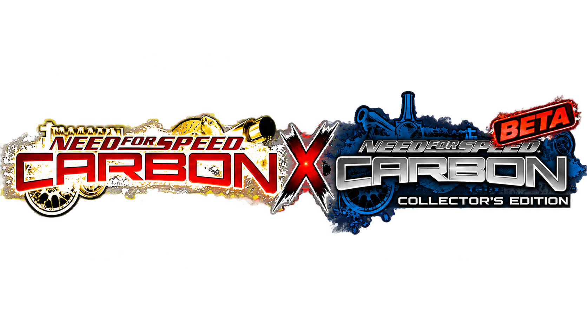
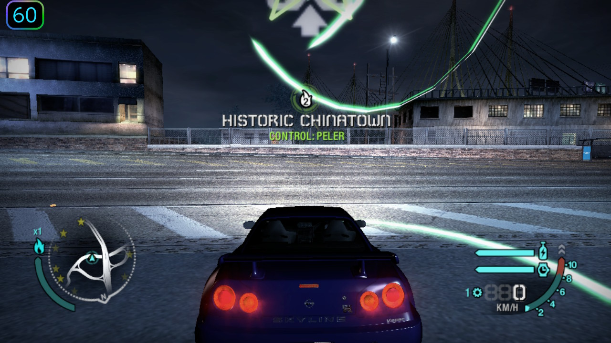
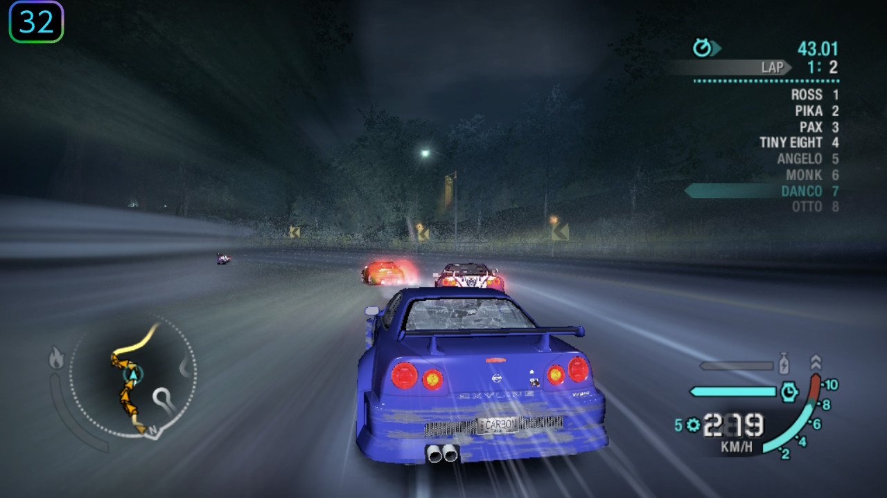
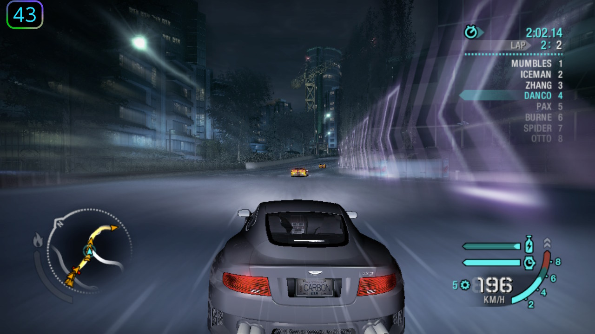
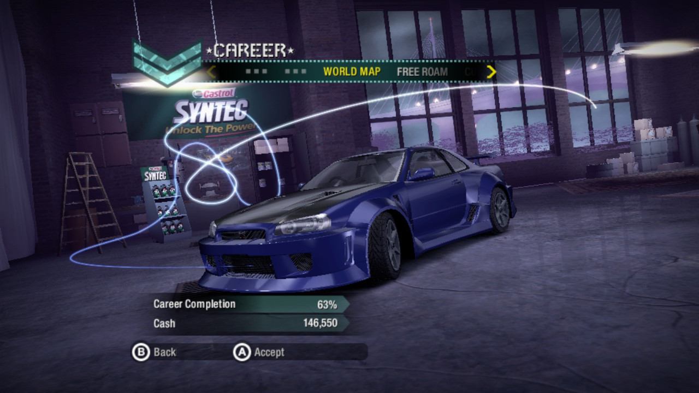
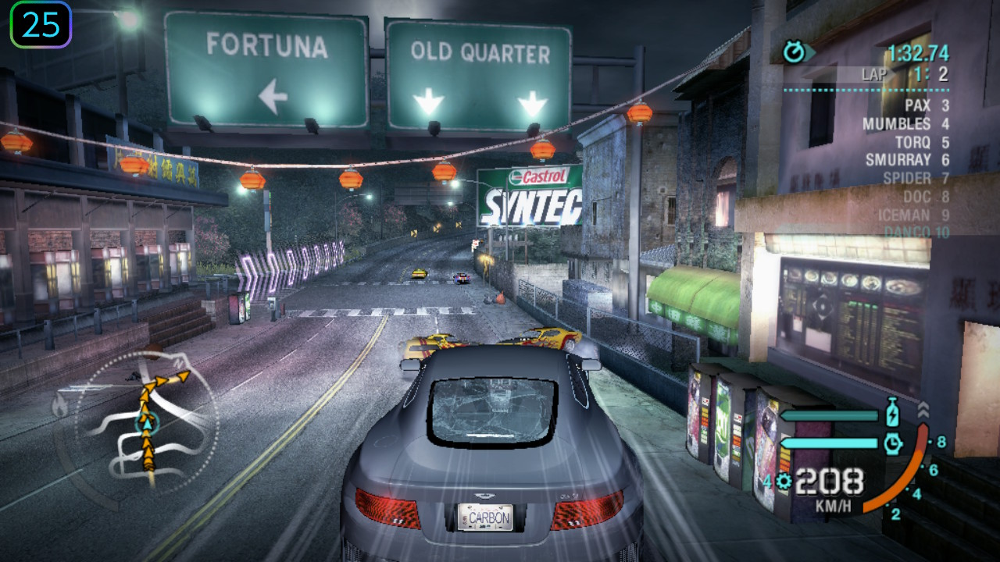
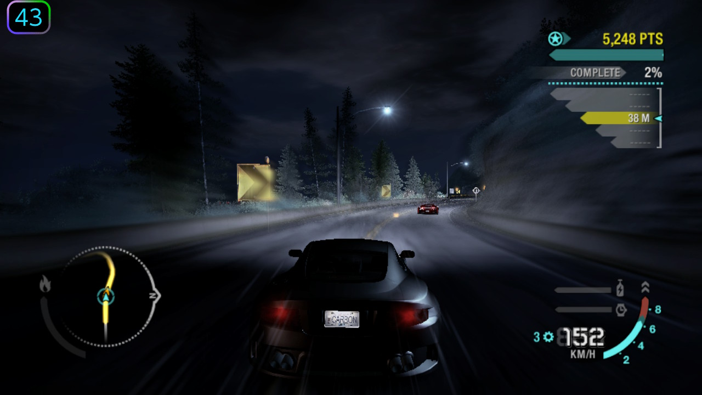

<div align="center">



# NFS Carbon NX

**Need for Speed: Carbon on the Nintendo Switch. Translated, not emulated.**

  -lightgrey)  [](https://ko-fi.com/ojojoj)

[Overview](#overview) · [Screenshots](#screenshots) · [Install](#install) · [Performance](#performance) · [What's new](#whats-new-in-100) · [Known issues](#known-issues) · [Report a problem](#report-a-problem) · [Docs](#documentation) · [Credits](#credits)

</div>

## Overview

NFS Carbon NX runs the **Xbox 360 release** of Need for Speed: Carbon natively on the Nintendo Switch. The PowerPC code of
the game's `default.xex` is translated to C++ with [ReXGlue](https://github.com/rexglue/rexglue-sdk) and compiled for the
Switch's ARM64 cores; the game's GPU commands are drawn by a purpose-built **Vulkan renderer** running on NVK (Mesa).
There is no emulation layer between the game and the hardware. You need your own copy of the game.

| | Standard Edition | Collector's Edition |
|---|---|---|
| Release | **1.0.0**, the first non-beta release | **1.0.0-collectors-beta.1**, beta |
| Boot, menus, career, saves | Work | Work, fewer hours of testing |
| Heaviest races (13 to 16 cars) | median **31 FPS**, 62% of the time at 30 FPS or more | **24 to 30 FPS** |
| Open roads, lighter races | 40 to 55 FPS | 45 to 55 FPS |
| Cutscenes | Work (FFmpeg, verified against the game's own decoder) | Not covered by testing yet |
| Audio | Clean in most windows; a heavy race start can still crackle | Same code, slightly worse in the heaviest races |
| DLC | Up to 30 packs | Up to 30 packs |
| Install folder | `switch/nfscarbon/` | `switch/nfscarbon-collectors/` |

Measured on a Switch in handheld mode at CPU 1428 MHz, GPU 768 MHz, memory 1600 MHz, scene drawn at 80% and upscaled with
FSR. Stock clocks are CPU 1020 MHz and GPU 460 MHz.

> [!IMPORTANT]
> **It is meant to be used with a CPU overclock.** The game's code runs on three Switch cores and the CPU is the limit. At stock
> handheld clocks it is too slow and the audio stutters. Read [Overclocking](#overclocking) and [Known issues](#known-issues)
> before you start.

### Highlights

- **Native renderer.** Xenos GPU commands become Vulkan draws; shaders are translated (microcode to GLSL to SPIR-V) and cached on the SD card.
- **FSR upscaling, bloom, 4x anisotropic filtering** on by default; every quality switch is in `nfscarbon.toml` ([settings](docs/CONFIG.md)).
- **Audio that holds up.** The output refills its cushion after a hiccup instead of going silent, and the game's mixer runs above the decoder and GPU threads.
- **Hand-written fast paths** where profiling showed the translated code is slow: mixer helpers (some NEON), cutscene decoding, texture untiling, vertex and constant uploads. Each has an off-switch.
- **DLC packages** load from a `dlc/` folder (up to 30).
- **Two editions, one runtime.** Collector's support shares the renderer, kernel and hooks; per-edition addresses live in one table.
- **Measured, not guessed.** Built-in statistics (`nfscarbon.report.toml`) produce the numbers on this page; every claim here comes from hardware logs.

## Screenshots

Captured on a Switch in handheld mode at the reference clocks. The number in the corner is the FPS at that moment.

<table>
<tr>
<td width="50%"><br><sub>Standard Edition: free roam, Historic Chinatown (60 FPS)</sub></td>
<td width="50%"><br><sub>Standard Edition: race at 219 km/h (32 FPS)</sub></td>
</tr>
<tr>
<td width="50%"><br><sub>Standard Edition: night race with the speed effects (43 FPS)</sub></td>
<td width="50%"><br><sub>Standard Edition: career menu</sub></td>
</tr>
<tr>
<td width="50%"><br><sub>Collector's Edition (beta): race in the Old Quarter (25 FPS, one of the heavy scenes)</sub></td>
<td width="50%"><br><sub>Collector's Edition (beta): canyon race at night (43 FPS)</sub></td>
</tr>
</table>

## Install

### What you need

- A Switch running custom firmware (Atmosphere) that can launch homebrew with title override.
- The Xbox 360 files of the game, extracted: `default.xex`, `NFS/` and `Movies/`, from a disc you own. Tested editions:

  | Edition | `default.xex` SHA-256 | Title / media | Region |
  |---|---|---|---|
  | Standard | `947f95c7306eabf5bc72972938df57a922798bafbc02edf1a9107f0462c721e1` | 454107EC / 51D2B53F | NTSC-U (USA) |
  | Collector's | `922c7a1a2fc77405c43aac5159ad67fb0414c872084abc3335c68dbb4bec1815` | 454107EC / 1F8BEB88 (version 7) | NTSC-U (USA) |

  Both tested dumps are the **USA (NTSC-U)** releases: the region flags in their executables are `0x000000FF`. Other
  editions and regions (PAL, NTSC-J) have not been tested and may crash or misbehave.
- The release files from the [Releases](../../releases) page: loose `.nro` and `.toml` files, no archive.

The game files are not included and never will be.

### SD card layout

**Standard Edition**

```text
sdmc:/switch/nfscarbon/
  nfscarbon.nro
  nfscarbon.toml          (quiet default settings)
  nfscarbon.report.toml   (full logging, for performance reports)
  game-data/
    default.xex
    NFS/
    Movies/
  dlc/                    (optional, see DLC)
```

**Collector's Edition (beta)** goes in its own folder, so both editions can be installed side by side (saves are separate;
use a fresh `user/` folder for the first test):

```text
sdmc:/switch/nfscarbon-collectors/
  nfscarbon-collectors.nro
  nfscarbon.toml
  nfscarbon.report.toml
  game-data/              (the Collector's Edition dump)
  dlc/                    (optional, see DLC)
```

### Launching

Launch with **title override**: hold **R** while starting an installed game, and pick a game that leaves the application
about 3.2 GB of memory (the log prints `proceso X/Y MB` and `[limits]` at startup; a host that gives less makes cutscene
threads fail).

A forwarder made with [Sphaira](https://github.com/NaGaa95/sphaira) works too. Generate it with the address space set to
**39-bit** (the default is too small and the game aborts while creating threads), and check the `[limits]` lines in the
log after the first run, because a forwarder gets its own memory budget.

The first time you play, shaders and pipelines are compiled as they are needed and cached on the SD card, so the first
races can stutter for a few seconds. Do not delete `user/cache`.

### Overclocking

The reference settings are CPU 1428 MHz, GPU 768 MHz and memory 1600 MHz. Use a clock manager of your choice (for example
Horizon OC or sys-clk) and set the profile for the game you launch it from. Overclocking is at your own risk: it can make
the console unstable, hot, or corrupt data. Back up your SD card and NAND, start with small steps and test stability.
This project does not provide overclocking tools.

### Controls

Each Switch button acts as the Xbox 360 button with the same letter. `+` is Start, `-` is Back, ZL/ZR are the triggers,
L/R the bumpers. Set `input_xbox_layout = true` in `nfscarbon.toml` to swap the face buttons by position. Controller
rumble is on; set `input_vibracion = false` to turn it off.

| Hold **L + R** and press | Action |
|---|---|
| Up | Debug overlay (FPS and counters) |
| Right | Settings overlay |
| Left | Achievements list |

### Settings

`nfscarbon.toml` next to the NRO holds the settings; every setting has a default and the file only lists what differs. The
ones that matter are in [docs/CONFIG.md](docs/CONFIG.md): render scale, upscaling filter, texture detail, anisotropic
filtering, bloom. The shipped file is **quiet**: it logs warnings only and statistics are off, because logging costs frame
rate (most at the race start). `carbon_gpu_bloom = false` saves about 4 ms of GPU time per frame in a crowded race.

## Performance

Handheld, 1428 / 768 / 1600 MHz, 80% with FSR, bloom on, 30 DLC packs installed. A window is the 5 seconds between two
statistics lines of the renderer; "heavy" means race wars (13 to 16 cars, about 1900 draws per frame).

| Windows with more than 300 draws | Standard | Collector's (beta) |
|---|---|---|
| FPS median / 10th / 90th percentile | 31.5 / 26.8 / 38.0 | 26.3 / 20.3 / 46.6 |
| Lowest | 18.7 | 15.5 |
| At 30 FPS or more | 62% | 29% |
| Under 25 FPS | 8% | 42% |

In the heaviest races the Standard Edition holds about 30 FPS; open roads and lighter races run 40 to 55 FPS. The Collector's
Edition is slower there because its translated game code keeps registers in memory between calls. Audio requests that found no
data per 10 seconds went from 50 to 410 in nearly every race window to none in most windows. The full measurements, what was
tried and did not help, and the older sessions are in [docs/PERFORMANCE.md](docs/PERFORMANCE.md).

## What's new in 1.0.0

Changes since 0.1.0-beta.8 (full list in [CHANGELOG.md](CHANGELOG.md)):

- **Collector's Edition support (beta).** Its own folder and NRO; the scheduling and audio hooks of the standard edition were
  ported with every address checked against the Collector's code, and the same renderer is used.
- **Much less audio stutter.** The output asked the game for exactly one frame per 5.3 ms, so once its 32-frame cushion emptied it
  never refilled and every small hiccup of the mixer became silence. It refills now, and the mixer thread runs above the XMA and
  GPU threads.
- **Bloom on by default**, and the pause menu background works with bloom off.
- **Car reflection pass refreshed every 30 frames** instead of being skipped for good.
- **DLC that survives interrupted installs.** A stale install journal used to make every install fail and hide all DLC; duplicate
  packs install once, install work folders are cleaned up with a fallback that works on the SD card, and at most 30 packs are
  listed to the game because 36 and 52 crashed the profile load.
- **New diagnostics** for performance reports: per-pass render timings and audio queue statistics, only in `nfscarbon.report.toml`.

Tried and dropped because they did not help: running the audio mixer at 44.1 kHz, skipping silent voices (about 7% of the
mixing) and lowering the model detail of the other racers.

## DLC

Put Xbox 360 DLC packages (the STFS files) anywhere under `dlc/`. At startup they are extracted into the content folder and the
game finds them through its normal content API. The log shows `[dlc] N package(s) installed, M failed`. The same file in two
folders is installed once.

**Keep to 30 packs or fewer.** 30 packs ran a long session without a crash; 36 and 52 crashed while the profile loaded (a call
to the garbage address `0xEEEEEEEE` right after the last pack's token file was read). The game is shown at most 30
(`content_max_marketplace_items`) and logs a warning when it drops some. Which items a pack unlocks is mostly untested.

<details>
<summary>Packages verified working, and what to do if the profile crashes</summary>

All 11 of these were installed together and a 57-minute career session ran on them (boss races, cutscenes, saves) without a
DLC-related crash. "Token" is the file the game opens inside the pack, seen in the log:

| Package (folder name in `dlc/`) | Token the game opened | Status |
|---|---|---|
| Dump Truck (Addon) | `Dump Truck.txt` | Verified working |
| Fire Truck (Addon) | `Fire Truck.txt` | Verified working |
| 1971 Dodge Challenger | `1971 Dodge Challenger.txt` | Verified working |
| 1987 Toyota Corolla GTS AE86 | `1987 Toyota Corolla GTS AE86.txt` | Verified working |
| 2006 Pagani Zonda | `zonda.txt` | Verified working |
| 2006 Porsche 911 Turbo | `2006 Porsche 911 Turbo.txt` | Verified working |
| Autosculpt Tuner Body Kit Bundle | `AS_Tuner_Body.txt` | Verified working |
| Exotic Car Kit Bundle | `Integrated_Kit_Exotic.txt` | Verified working |
| Ultimate Performance Bundle | `Uber_Performance_T1.txt`, `T2`, `T3` | Verified working |
| Exotic Base Car Bundle | `snips.txt`, `william.txt` (shared with the next row) | Verified working |
| Need for Speed Carbon CE Bundle | `snips.txt`, `william.txt` (shared with the previous row) | Verified working |

Verified means the pack loaded and the game ran; it does not mean every item inside the pack was checked in the game. A later
30-pack run also loaded more bundles (performance tiers, custom and base car bundles, the Maximum Carbon Bundle) and ran fine.
Removing a package from `dlc/` does **not** uninstall its extracted copy in `user/`.

**If the game crashes while loading the profile after you changed your DLC** (the log ends right after a line like
`[dlc] el juego abre 'save:\...'`, and `rex_crash.log` reports a call to an invalid guest address):

1. Back up `sdmc:/switch/nfscarbon/user/` first.
2. Delete everything inside these three folders (only the extracted DLC and its install work data, never the other folders in
   `user/`, those hold your profile and saves):
   - `sdmc:/switch/nfscarbon/user/0000000000000000/454107EC/00000002/`
   - `sdmc:/switch/nfscarbon/user/0000000000000000/454107EC/Headers/00000002/`
   - `sdmc:/switch/nfscarbon/user/0000000000000000/454107EC/.dlc-install/`
3. Start the game. The packages in `dlc/` are extracted again at launch. If it still crashes, move most packages out of `dlc/`
   and add them back a few at a time (30 at most).

</details>

## Known issues

- **Below the reference clocks**, audio drop-outs and low frame rates are likely: the game's software mixer needs more CPU than
  three slow cores give.
- **Audio is much better but not perfect.** A heavy race start can still crackle for a few seconds: in the latest runs 4 of 23
  busy windows of 10 seconds had more than 50 audio requests without data (worst 135, median 1). The mixer needs about 3.8 ms of
  CPU per 5.3 ms block there, with no headroom, and the CPU is saturated.
- **Frame rate** in race wars is about 30 FPS on the Standard Edition and 24 to 30 on the Collector's beta.
- **Flashing shadows.** For a few frames, car shadows can turn into black patches next to a washed-out white road. It appears
  only while the motion blur or tunnel vision effect is on, at speed (around 120 to 150 km/h) with strong light and many cars.
  It is not caused by bloom or by the car reflection pass (both tested). Cause still unknown.
- **Collector's Edition is a beta**: slower, and with fewer hours of testing.
- **Achievements** are not confirmed. The SDK handles the unlock call, but no unlock has been seen in the logs.
- A title-override host with a small memory budget can make a cutscene fail (the game waits for a thread that was never created
  and appears frozen); pick a host that leaves about 3.2 GB.

More detail in [docs/KNOWN_ISSUES.md](docs/KNOWN_ISSUES.md).

## Report a problem

**If you send an issue report, I will address it.** This is a one-person project, so a good report is the fastest way to get
something fixed, and where it runs well and where it does not depends on the console, the clocks and the scene. To report one:

1. Play for at least one race and note the edition, the clocks you used and what went wrong.
2. For performance and audio problems, copy `nfscarbon.report.toml` over `nfscarbon.toml` for one session (it logs everything; put your normal file back afterwards).
3. Copy `sdmc:/switch/nfscarbon/logs/` (or `nfscarbon-collectors/logs/`) to your PC and run
   `powershell -File scripts/pack-logs.ps1 -Logs <that folder>`. It writes a zip and prints a summary (FPS spread, draws, GPU
   time, audio drop-outs, clocks).
4. [Open an issue](../../issues/new/choose) with the **Performance / audio report** template and attach the zip. For a crash,
   include `logs/rex/rex_crash.log`.

The logs contain your save profile names and SD paths; remove what you do not want to share. Never attach game files.

## How it works

- **Translated, not emulated.** ReXGlue turns every function of `default.xex` into C++ and gives the game the Xbox 360
  kernel, files, audio and controllers it expects. This project adds the Switch side: memory, threads, clocks, audio output
  and presenting frames.
- **Native renderer.** The game's GPU command stream is read and drawn with Vulkan (`renderer/`), with its own shader
  translation cached on disk. Vulkan comes from NVK, via [mesa-switch](https://github.com/danfromtico/mesa-switch).
- **Upscaling.** The scene is drawn at 80% of 1280x720 and scaled up with FSR (or CAS or bilinear, your choice).
- **Hand-written fast paths** where profiling showed the recompiled code is slow: audio mixer helpers (some with NEON), the
  cutscene decoder (FFmpeg WMV3, verified against the game's own output), texture untiling, vertex and constant uploads.
- **Two editions, one runtime.** The Collector's Edition is translated from its own `default.xex`; the hooks take their
  addresses from a per-edition table (`src/edition.h`).

The whole path from `default.xex` to a frame is in [docs/HOW_IT_WORKS.md](docs/HOW_IT_WORKS.md).

## Documentation

- [docs/HOW_IT_WORKS.md](docs/HOW_IT_WORKS.md): from `default.xex` to a frame, in order.
- [docs/PERFORMANCE.md](docs/PERFORMANCE.md): measured sessions, explained.
- [docs/CONFIG.md](docs/CONFIG.md): every setting.
- [docs/BUILD.md](docs/BUILD.md): building from source.
- [docs/KNOWN_ISSUES.md](docs/KNOWN_ISSUES.md): problems we know about, and what was fixed.
- [CHANGELOG.md](CHANGELOG.md): what changed in each version.
- `scripts/summarize_run.py <logs folder>`: turns your logs into FPS, draws, GPU time and audio drop-out numbers.

## Building

You build it yourself from your own `default.xex`; the translated game code is never distributed.
[docs/BUILD.md](docs/BUILD.md) has the full procedure. Dependencies are pinned in `dependencies.json`; changes to the
upstream source trees are kept as patches in `patches/`. The verified host is Windows with PowerShell.

## Support

This is a free-time project. Testing on real hardware takes many hours, and the AI assistants used for development are not
free. If you like the work, you can kindly leave a tip on [Ko-fi](https://ko-fi.com/ojojoj). It is never required, and the
port stays free.

[](https://ko-fi.com/ojojoj)

## Credits

- **[zofo007](https://github.com/zofo007)**: made and maintains this port (Switch runtime, hooks, testing, releases).
- **Electronic Arts / EA Black Box**: Need for Speed: Carbon. This is an unofficial fan project.
- **[Sampreeth004](https://github.com/Sampreeth004/nfs-carbon-recomp)**: the Carbon recompilation and the native
  Vulkan renderer this project is built on. Without this work the Switch port would not exist; it is the foundation
  of everything here. Thank you.
- **[StevensND](https://github.com/StevensND/nfsmw-nx)**: the Most Wanted Switch port. Its Horizon layer of the SDK is
  used here, and many ideas (audio packet wait, frame hand-off, FFmpeg cutscenes, overlays, memory handling) were
  studied from it. No Most Wanted assets, addresses or game code are used.
- **[madelrandel-blip](https://github.com/madelrandel-blip/NFSMW-Recompiled)** and
  **[victorgbd](https://github.com/victorgbd/NFSMW-Recompiled-Mobile)**: the Most Wanted recompilation projects whose
  hooks Carbon's code was ported from.
- **Tom Clay** and the **[Xenia](https://xenia.jp)** team: [ReXGlue SDK](https://github.com/rexglue/rexglue-sdk).
- **[danfromtico](https://github.com/danfromtico/mesa-switch)**, **NaGaa95** and the Mesa project: NVK on Horizon.
- **[devkitPro](https://devkitpro.org)** and **[switchbrew](https://github.com/switchbrew/libnx)**: devkitA64, libnx.
- **FFmpeg**, glslang, SPIRV-Tools, Vulkan Memory Allocator, fmt, spdlog, SIMDe and the other libraries listed in
  [THIRD_PARTY_NOTICES.md](THIRD_PARTY_NOTICES.md).

### Related projects

- [StevensND/nfsmw-nx](https://github.com/StevensND/nfsmw-nx): Need for Speed: Most Wanted on the Switch, the closest
  relative of this port.
- [codepdbh/NFS-CARBON-360-ANDROID-RECOMP](https://github.com/codepdbh/NFS-CARBON-360-ANDROID-RECOMP) and
  [codepdbh/nfsmw-android](https://github.com/codepdbh/nfsmw-android): Carbon and Most Wanted for Android, from the
  same family of recompilation projects. Nothing from them is used here.

Development used AI coding assistants (OpenAI Codex and Anthropic Claude Code) under the maintainer's direction; hardware
testing and every release decision are the maintainer's.

## Legal

**This project does not modify any game files.** It reads your game files and never writes to them: saves, caches and
installed DLC go to separate folders (`user/`). It is meant to be used **only with dumps of original game discs that you own**,
made by you. It is not a way to obtain the game: do not ask for game files and do not share them.

This repository contains no code or assets from the original game: no executable, archives, movies, shaders or generated guest
code. You must supply your own legally obtained copy. "Need for Speed" is a trademark of Electronic Arts Inc.; Nintendo Switch
is a trademark of Nintendo; Xbox 360 is a trademark of Microsoft. This project is not affiliated with or endorsed by any of
them. Running homebrew needs custom firmware, which Nintendo's terms forbid and which can get a console banned. Use it at your
own risk.

License: see [LICENSE](LICENSE) and [THIRD_PARTY_NOTICES.md](THIRD_PARTY_NOTICES.md).